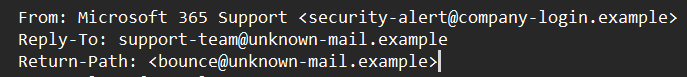
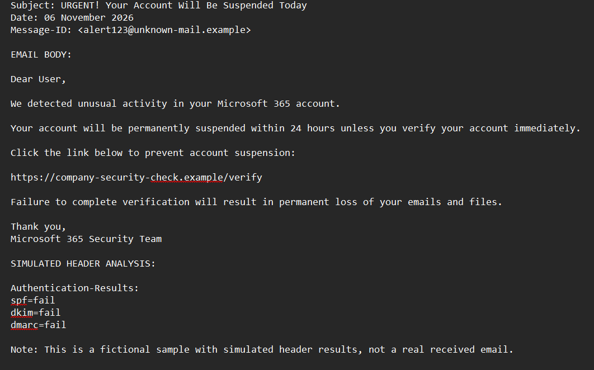

# Phishing Email Analysis Report

## 1. Introduction

This project focuses on analysing a simulated phishing email to identify common email-based threats, suspicious sender details, malicious-link indicators, and social-engineering techniques.

## 2. Objective

To identify phishing characteristics and understand how attackers use email spoofing, suspicious links, urgency, and fear to trick recipients.

## 3. Tools Used

- Windows Notepad
- Simulated phishing email sample
- Google Admin Toolbox Messageheader (reference tool for header analysis)

## 4. Email Sample Details

**Subject:** URGENT! Your Account Will Be Suspended Today

**Claimed sender:** Microsoft 365 Support

**Sender address:** security-alert@company-login.example

**Reply-To:** support-team@unknown-mail.example

**Return-Path:** bounce@unknown-mail.example

## 5. Phishing Indicators Identified

### 5.1 Sender Address Inconsistency

The From, Reply-To, and Return-Path addresses use different domains. The sender claims to represent Microsoft, but the addresses do not use Microsoft's official domain.

**Risk:** This inconsistency may indicate sender impersonation or an attempt to redirect replies.

### 5.2 Urgent and Threatening Language

The email claims that the account will be suspended within 24 hours and threatens permanent loss of emails and files.

**Risk:** This creates fear and pressures the recipient to act without checking the message.

### 5.3 Suspicious URL

The email contains:

`https://company-security-check.example/verify`

The domain does not match Microsoft's official domain, microsoft.com.

**Risk:** The link could direct a recipient to an impersonation or credential-harvesting page. It was not opened during this analysis.

### 5.4 Social Engineering

The email uses:

- A generic greeting: "Dear User"
- Urgency and time pressure
- Fear of account suspension
- Threats of losing emails and files
- Impersonation of a trusted company

### 5.5 Email Authentication Results

The sample contains these simulated authentication results:

- SPF: FAIL
- DKIM: FAIL
- DMARC: FAIL

These results indicate failed authentication checks in the fictional sample.

**Important limitation:** These values were manually included in the training sample. They were not obtained from a real email header or an online header analyzer.

### 5.6 Spelling and Grammar

No major spelling or grammar errors were identified. An email can still be phishing even when its language is grammatically correct.

## 6. Evidence Screenshots

### 6.1 Sender Analysis

### 6.2 Email Body Analysis

### 6.3 Suspicious URL

## 7. Security Recommendations

- Verify the sender using an independently obtained official contact method.
- Check whether the sender and Reply-To domains are consistent.
- Never click suspicious links or open unexpected attachments.
- Inspect the actual destination domain before trusting a link.
- Treat urgent account suspension warnings with caution.
- Report suspected phishing emails to the organisation's IT or security team.
- Delete or quarantine confirmed phishing emails according to organisational policy.
- Never enter passwords or sensitive information on unverified websites.

## 8. Conclusion

The simulated email demonstrates several common phishing indicators, including sender-address inconsistencies, suspicious links, urgency, threats, and brand impersonation.

The analysis helped demonstrate how phishing emails use social engineering to manipulate recipients into revealing sensitive information or taking unsafe actions.

This exercise improved awareness of phishing tactics and basic email threat-analysis techniques.

## 9. Limitations

This exercise used a fictional training email. No real email was received, no live malicious link was visited, and no actual email headers were collected. Authentication results were simulated for educational purposes.
